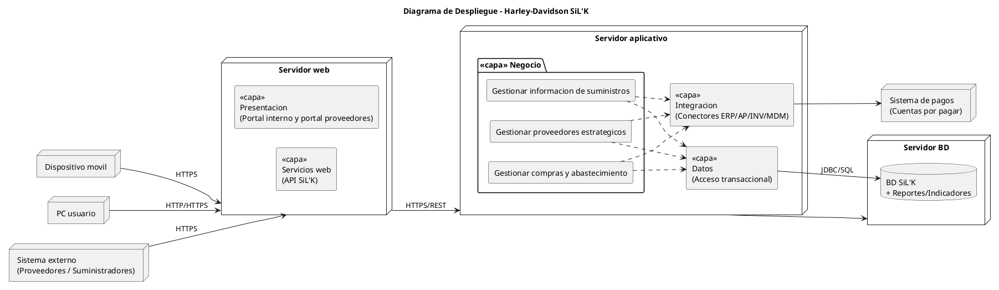

# Diagrama de Despliegue - Harley-Davidson SiL'K

## Objetivo

Definir la arquitectura de despliegue de SiL'K basada en lo ya establecido en el proyecto:

- CUN-01: Gestionar proveedores estrategicos
- CUN-02: Gestionar compras y abastecimiento
- CUN-03: Gestionar informacion de suministros

## Diagrama (PlantUML)

## Trazabilidad de arquitectura con el alcance definido

- Gestionar proveedores estrategicos: evaluar y seleccionar proveedores, desarrollar relaciones, gestionar rendimiento e integrar proveedores en desarrollo de producto.
- Gestionar compras y abastecimiento: procesar requisiciones, emitir ordenes de compra, gestionar recepcion de materiales y procesar facturas de proveedores.
- Gestionar informacion de suministros: gestionar resultados, integracion y contactos de suministradores.

## Vista por capas

- Capa de acceso: dispositivo movil, PC usuario y sistema externo.
- Capa web: presentacion y servicios web (API SiL'K).
- Capa aplicativo: negocio, datos e integracion.
- Capa de datos fisica: servidor BD con base transaccional y reportes.
- Sistema externo de pagos: integrado desde la capa de integracion.

## Supuestos minimos (alineados al caso)

- La solucion no reemplaza totalmente los sistemas existentes, los integra.
- El acceso se canaliza por un servidor web unificado para usuarios y proveedores.
- La operacion requiere disponibilidad continua por impacto en compras y abastecimiento.
- Los indicadores de desempeno de suministradores se alimentan desde eventos transaccionales.
